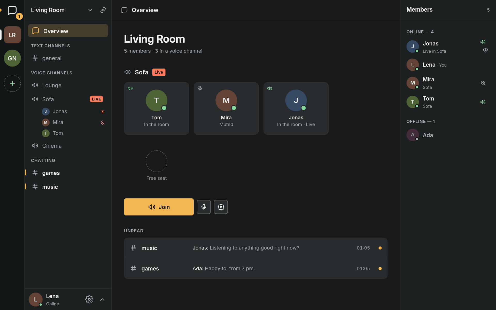
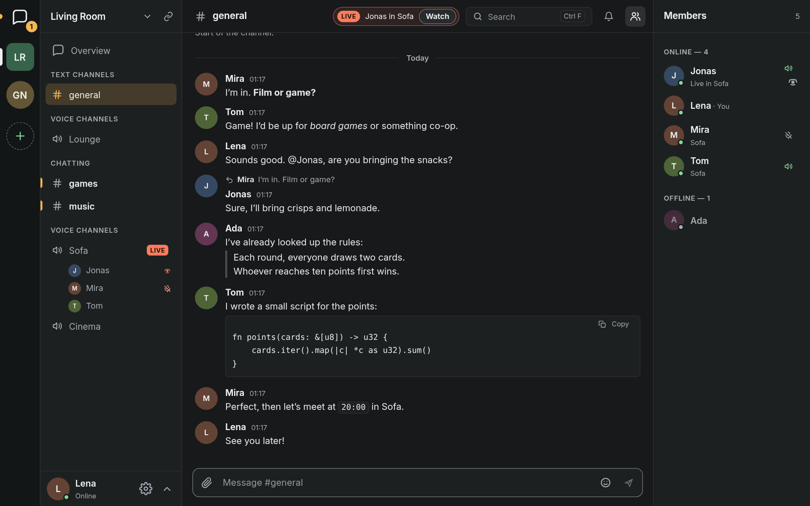
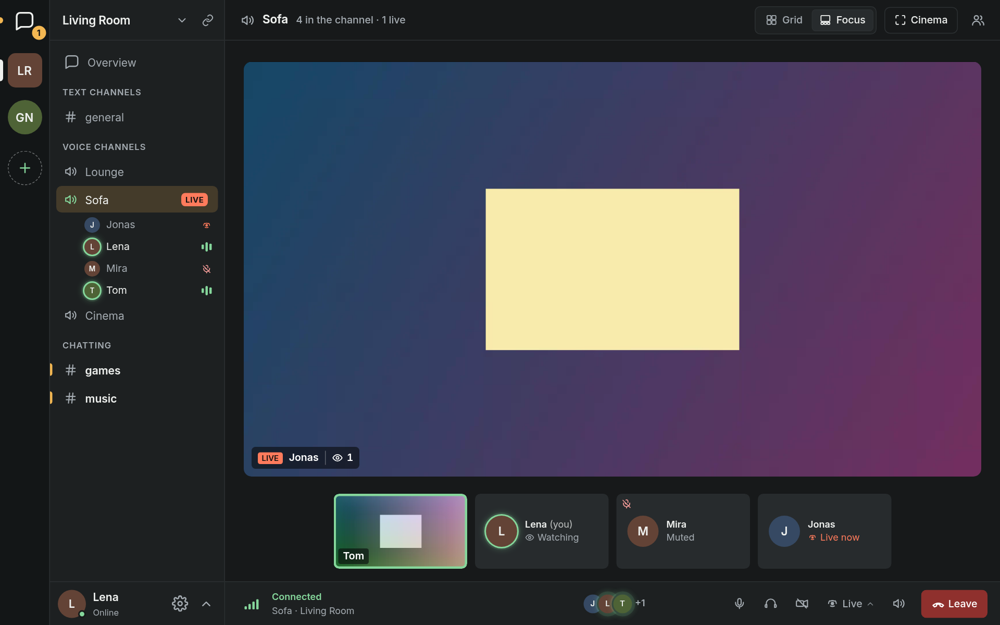

# Gelabber

**Chat, voice and live screen sharing for a community, on your own server.**

[](https://github.com/Till-und-Scholler-AI-slop/Gelabber/actions/workflows/ci.yml)
[](https://github.com/Till-und-Scholler-AI-slop/Gelabber/releases/latest)
[](LICENSE)

Gelabber gives a group text channels, voice channels and Go Live: whoever
goes live shows everyone in the voice channel a screen or a window, and
several people can be live at once. It runs from one `docker compose up`,
in the browser and as a native desktop app for Linux and Windows.

*Selbst hosten, frei reden.*



<p align="center">
  
  
</p>

## Features

- **Voice rooms** with camera and Go Live, several streams at the same time,
  three stage views (grid, focus, cinema) and a call bar that stays with
  you while you read chat.
- **Text chat:** servers with channels and categories, direct messages,
  replies, reactions, search, link previews, GIFs, file attachments.
- **Clients:** a web app that installs as a PWA, and a native desktop app
  for Linux and Windows with global push-to-talk, a tray icon and its own
  updater.
- **Noise suppression in the client** (RNNoise, self-hosted assets). No
  audio leaves your server for processing.
- **Themes:** 14 presets and a theme editor, checked for contrast.
- **Notifications:** Web Push and desktop notifications, per channel and
  per server.
- **Self-hosted media:** your own mediasoup SFU and coturn. Signaling is
  Gelabber's own WebSocket protocol; no third-party call service is
  involved.
- **Operations:** Prometheus metrics, a Grafana dashboard, backup and
  restore scripts, a release gate that promotes exactly the images CI
  tested.

## Status

Gelabber is built and run by two people and used daily by one group of
friends. What that means for you:

- Releases are frequent; see the
  [release notes](https://github.com/Till-und-Scholler-AI-slop/Gelabber/releases).
  Each one says what was checked and what was not.
- Both clients, web and desktop, speak German and English; each account
  chooses its language.
- Calls with more than a handful of people and communities beyond the
  authors' own have not been measured.
- The Windows installer is not code-signed, so SmartScreen warns on the
  first install.

## Quick start

You need Docker with Compose.

```bash
git clone https://github.com/Till-und-Scholler-AI-slop/Gelabber.git
cd Gelabber
cp deploy/compose/.env.example deploy/compose/.env
cd deploy/compose
docker compose up
```

Then open [http://localhost](http://localhost) and create an account.

- Compose pulls the published images
  (`ghcr.io/till-und-scholler-ai-slop/gelabber/{api,web,media}`).
  `docker compose up --build` builds them from source instead; on arm64
  that is required, because the published images are `linux/amd64`.
- Postgres, Redis and the MinIO console listen on loopback only.
- Voice needs UDP that does not pass through the reverse proxy: coturn on
  3478 plus its relay range, and the SFU on 10000 plus one port per further
  media worker.

For a real deployment (TLS, an existing reverse proxy, TURN, backups,
metrics, upgrades and rollbacks) read the
[operator guide](deploy/README.md). Before you expose an instance, read its
"Security" section.

## Desktop app

| Platform | Install |
|---|---|
| Windows | `gelabber-native-windows-x64-setup.exe` from the [latest release](https://github.com/Till-und-Scholler-AI-slop/Gelabber/releases/latest). It updates itself afterwards. |
| Arch Linux | `curl -fsSL https://till-und-scholler-ai-slop.github.io/Gelabber/install.sh \| sudo sh` adds the signed pacman repository and installs `gelabber-desktop`. Details and the key fingerprint: [desktop/packaging/arch/README.md](desktop/packaging/arch/README.md). |
| Other Linux | `gelabber-native-linux-x64.tar.gz` from the latest release. |

On its first start the app asks for your server's address. Phones use the
web app: [installing Gelabber as a PWA](docs/v0.6-pwa.md).

## Documentation

| Topic | Where |
|---|---|
| Running an instance | [deploy/README.md](deploy/README.md) |
| The desktop app: building, tests, updates | [desktop/README.md](desktop/README.md) |
| Protocols and UI reference for the native client | [docs/native/](docs/native/) |
| The SFU: build, checks, rollback | [docs/v0.4-mediasoup-migration.md](docs/v0.4-mediasoup-migration.md) |
| Upgrade and storage restore drill | [docs/upgrade-storage-restore.md](docs/upgrade-storage-restore.md) |
| Rules for changes and for CI | [AGENTS.md](AGENTS.md), [CONTRIBUTING.md](CONTRIBUTING.md) |

## Repository layout

| Path | What it is |
|---|---|
| `backend/api/` | REST API and WebSocket gateway: Rust, axum, sqlx on Postgres, Redis, S3 storage |
| `backend/media/` | The SFU service: mediasoup through its official Rust binding |
| `backend/shared/` | What API and SFU must agree on (media tickets, ICE URLs, emoji data) |
| `web/` | The web client: React, Vite, mediasoup-client, a service worker with Web Push |
| `desktop/` | The native app: egui, with a C++ media core on libwebrtc and libmediasoupclient; its own Cargo workspace |
| `deploy/` | Docker Compose with Caddy, Postgres, Redis, MinIO, coturn, Prometheus and Grafana |

Dependency versions are pinned exactly; the manifests and
`deploy/compose/compose.yaml` hold them.

## Development

Without Compose, with Postgres, Redis and MinIO running locally:

```bash
cd backend
set -a; . api/.env.example; set +a; cargo run -p gelabber-api
set -a; . media/.env.example; set +a; cargo run -p gelabber-media
cd ../web && npm run dev
```

`npm run dev` proxies `/api` and `/ws` to `:8080` and `/media` to `:8081`.
The media service builds mediasoup's native worker; set up the
[pinned native build tools](docs/v0.4-mediasoup-migration.md#gepinnter-nativer-build)
first.

Checks, as CI runs them:

| Area | Commands |
|---|---|
| Backend (`backend/`) | `cargo fmt --all -- --check`, `cargo clippy --locked --workspace --all-targets -- -D warnings`, tests through `backend/build/run-native-ci.sh` (see [AGENTS.md](AGENTS.md)) |
| Web (`web/`) | `npm run lint`, `npm test`, `npm run test:checks`, `npm run build` |
| Desktop (`desktop/`) | see [desktop/README.md](desktop/README.md); it needs a prebuilt libwebrtc package |
| Deployment | `python3 -m unittest discover -s deploy/compose/tests` |

Call sounds are synthesized in the client
(`web/src/voice/callSoundSynth.ts`), there are no audio files;
`npm run test:call-sounds-smoke` in `web/` checks them in a browser without
a running API.

## Contributing

Issues and pull requests are welcome. [CONTRIBUTING.md](CONTRIBUTING.md)
says how branches, reviews and releases work here.

## Security

Please report a vulnerability privately, not in a public issue:
[SECURITY.md](SECURITY.md).

## License

[MIT](LICENSE). Third-party components keep their own licenses:
[desktop/packaging/native/THIRD-PARTY-NOTICES.txt](desktop/packaging/native/THIRD-PARTY-NOTICES.txt)
for the desktop app, and the license files next to the bundled fonts, emoji
and RNNoise assets.
